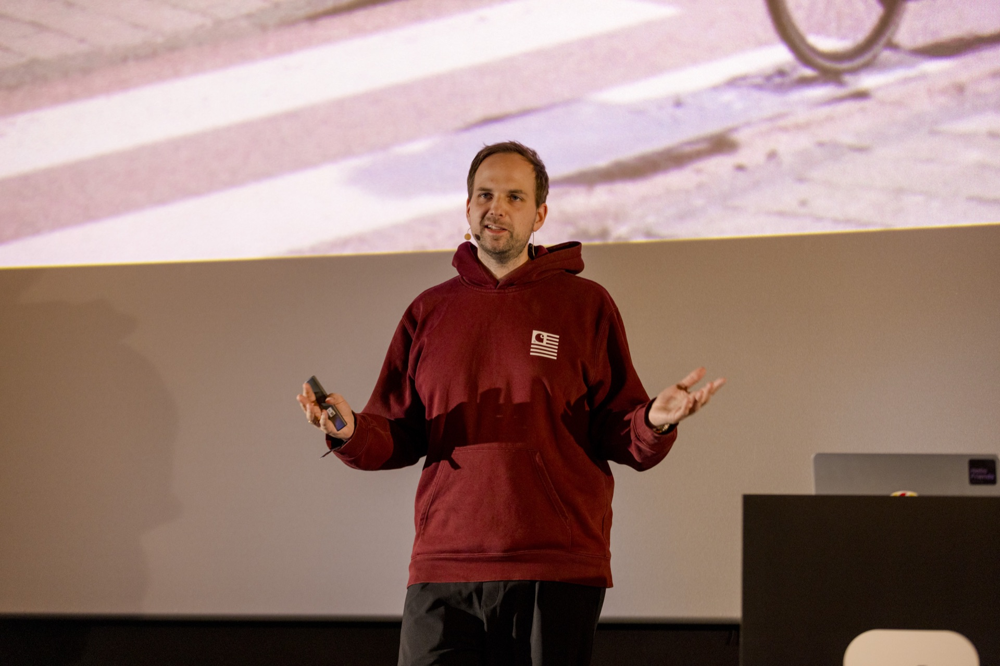

{}

## For Event Organizers

### Images

Pictures of me you can use without asking:

| Photo | Small | Full size |
| --- | --- | --- |
| Headshot | [400 × 400](/images/klaus-breyer-headshot-small.jpg) | [2287 × 2287](/images/klaus-breyer-headshot.jpg) |
| Full A | [280 × 280](/images/klaus-breyer-a-small.jpg) | [4370 × 4370](/images/klaus-breyer-a-full.jpg) |
| Full B | [204 × 280](/images/klaus-breyer-b-small.jpg) | [3761 × 5163](/images/klaus-breyer-b-full.jpg) |
| Speaking 2 | [1920 × 1280](code-talks-2026-02.jpg) | [5000 × 3335](code-talks-2026-02-original.jpg) |
| Speaking 3 | [1280 × 1920](code-talks-2026-03.jpg) | [3335 × 5000](code-talks-2026-03-original.jpg) |

### Socials

**[v01.io](https://www.v01.io/?nl)** | **[LinkedIn](https://www.linkedin.com/in/klaus-breyer/)** |**[Twitter](https://twitter.com/klausbreyer)**

### 🇺🇸 English Bio

#### Full Bio

Klaus is an experienced B2B SaaS CPTO with a passion for breaking down silos. As a startup founder and business unit lead, he bridges the gap between technical delivery and agile product strategy. Sometimes, he invests or advises, helping leadership teams build interdisciplinary teams themselves.

He has founded and led the startups [Buddybrand](https://www.buddybrand.com/) (digital agency) and [BuzzBird](https://www.buzzbird.de/) (B2B marketplace) and have built corporate startup business units for [Voith](https://voith.com) (IoT / B2B SaaS) and [edding](https://www.edding.com/de-de/) (B2B SaaS).

Based in Berlin, Klaus brings extensive international experience and enjoys working with diverse teams—mostly, but not exclusively, in remote environments. He is also a [speaker](pages/speaking), [blogger](posts), and [book author]().

His philosophy: Move Fast And Break Silos.

#### Short Bio

Klaus is an experienced B2B SaaS CPTO with a passion for breaking down silos. As a startup founder and business unit lead, he bridges the gap between technical delivery and agile product strategy. Sometimes, he invests or advises, helping leadership teams build interdisciplinary teams themselves.

His philosophy: Move Fast And Break Silos.

### 🇩🇪 German Bio

#### Full Bio

Klaus ist ein erfahrener B2B SaaS CPTO mit einer Leidenschaft dafür, Silos aufzubrechen. Als Startup-Gründer und Business Unit Lead schlägt er die Brücke zwischen technischer Delivery und agiler Produktstrategie. Gelegentlich investiert oder berät er und unterstützt Führungsteams beim Aufbau interdisziplinärer Teams.

Sein Motto: Move Fast and Break Silos.

Er hat die Startups [Buddybrand](https://www.buddybrand.com/) (Digitalagentur) und [BuzzBird](https://www.buzzbird.de/) (Influencer/B2B-Marktplatz) gegründet und geleitet sowie Corporate-Startups und Business Units für [Voith](https://voith.com) (IoT/B2B SaaS) und [edding](https://www.edding.com/de-de/) (B2B SaaS) aufgebaut.

Klaus lebt in Berlin, verfügt über umfangreiche internationale Erfahrung und arbeitet bevorzugt mit diversen Teams – meist, aber nicht ausschließlich, in Remote-Umgebungen. Zudem ist er [Speaker](pages/speaking), [Blogger](posts) und [Buchautor]().

#### Short Bio

Klaus ist ein erfahrener B2B SaaS CPTO mit einer Leidenschaft dafür, Silos aufzubrechen. Als Startup-Gründer und Business Unit Lead schlägt er die Brücke zwischen technischer Delivery und agiler Produktstrategie. Gelegentlich investiert oder berät er und unterstützt Führungsteams beim Aufbau interdisziplinärer Teams.

Sein Motto: Move Fast and Break Silos.
