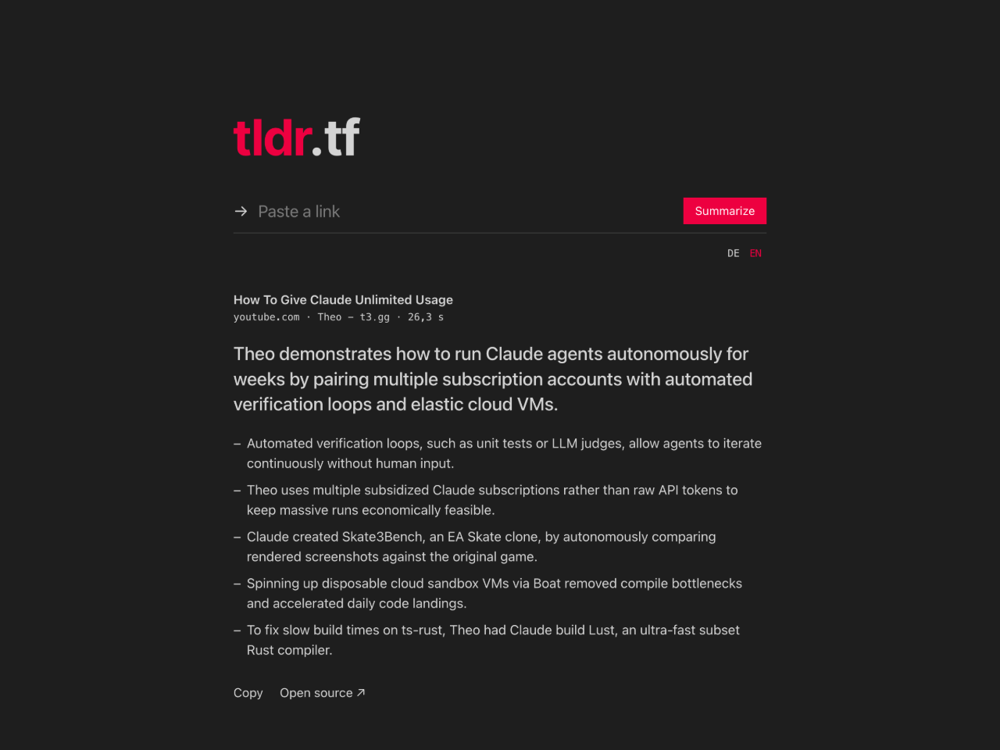
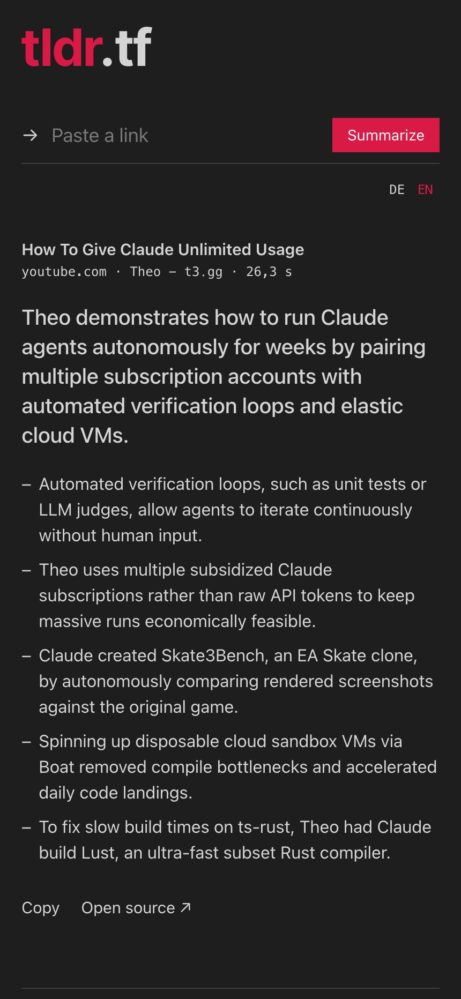

"How To Give Claude Unlimited Usage." 26 Minuten. Ich will nur die Antwort.

Mein YouTube-Feed ist voll mit solchen Titeln. Eine Frage im Titel, die Antwort irgendwo in Minute 18. Davor: ein Sponsor, ein Rückblick aufs letzte Video, die Bitte zu abonnieren. Ich mache den Creator:innen keinen Vorwurf. Der Algorithmus belohnt genau das. Aber ich öffne das Video, spule herum, gebe auf, und die Frage bleibt offen.

Die üblichen Werkzeuge haben das für mich nicht gelöst. Browser-Erweiterungen wollen alles mitlesen, was ich tue. Transkript-Zusammenfasser sehen nur die Wörter und verpassen, was auf dem Bildschirm passiert, und das ist bei einem Produkttest oder einem Vortrag die Hälfte des Inhalts. Und jedes dieser Werkzeuge will einen Account und einen Verlauf von dem, was ich geschaut habe.

Also habe ich das kleine Ding selbst gebaut. Es heißt [tldr.tf](https://tldr.tf) und ist Open Source. Link einfügen, einen Satz und ein paar Punkte bekommen.

## Was es macht

Ein Feld nimmt jede Adresse. Eine Webseite oder ein YouTube-Video, du musst nicht sagen, was es ist.

- **Ein Satz, ein paar Punkte.** Das tldr sagt, was die Quelle behauptet, nicht, worum es geht. Nicht "Theo spricht über Claude-Agenten", sondern "Theo lässt Claude-Agenten wochenlang laufen, indem er mehrere Abos mit automatischen Prüfschleifen kombiniert." Dann drei bis sechs Punkte mit den Namen, Zahlen und Beispielen.
- **Gemini schaut das Video.** Kein Transkript. Das Modell bekommt die Videoadresse und sieht Bild und Ton. Ein Produkttest zeigt das Produkt, ein Vortrag zeigt seine Folien, und die Zusammenfassung weiß das.
- **Meinungen tragen einen Namen.** Wenn jemand etwas behauptet, steht das auch so da: "Laut Theo ...". Eine umstrittene Aussage wird nie als Tatsache hingestellt.
- **Nichts zum Zusammenfassen? Dann steht das da.** Eine Paywall, ein Login, eine Fehlerseite: Das tldr sagt das klar und erfindet nichts.
- **Deutsch oder Englisch.** Die Zusammenfassung kommt in deiner Sprache, egal in welcher Sprache die Quelle ist. Ein japanisches Video gibt eine deutsche Zusammenfassung, wenn du Deutsch liest.
- **Mehrere Links auf einmal.** Drei einfügen, drei Zusammenfassungen bekommen, die neueste oben.

Eine Seite dauert ein paar Sekunden. Ein langes Video dauert bis zu einer Minute, und die Seite sagt das, während Gemini schaut.

## Was es nicht ist

Es gibt keinen Account, keinen Verlauf und keine Datenbank. Ein Link kommt rein, eine Zusammenfassung geht raus, und nichts überlebt die Anfrage. Lade die Seite neu und die Liste ist weg. Das ist kein fehlendes Feature. Es ist der Grund, warum ich ihm meine eigenen Links anvertraue, und der Grund, warum du das auch kannst.

Es gibt keine Browser-Erweiterung, keine App, keinen Chat mit dem Video. PDFs und Dateien gehen noch nicht. Private und altersbeschränkte Videos scheitern, weil Google sie dem Modell nicht zeigt.

Ein Produkt ist fertig, wenn man nichts mehr wegnehmen kann.

## Warum Elixir und Gemini

Das ganze Produkt ist eine Funktion: Adresse prüfen, Seite holen oder Video übergeben, ein Modellaufruf mit striktem JSON-Schema, einen Satz und eine Liste zurückgeben. Phoenix LiveView zeigt den Wartezustand und das Ergebnis ohne eine Zeile Frontend-Framework. Jeder Link läuft in seinem eigenen Prozess, drei Links auf einmal sind also drei Prozesse und keine Warteschlange.

Gemini ist die eine Modellfamilie, die ein YouTube-Video anhand seiner Adresse anschaut. Der Aufruf geht über OpenRouter an Gemini 3.8 Flash.

Das Ganze läuft in einem Container bei Bunny in Deutschland. Jeder Push auf `main` deployt es.

## Probier es aus

Geh auf [tldr.tf](https://tldr.tf) und füge das nächste Video ein, das du nicht schauen willst.

Der Code liegt auf [github.com/klausbreyer/tldr](https://github.com/klausbreyer/tldr). Du kannst es auch für dich selbst aufsetzen, wenn du magst: Repository klonen, deinen eigenen OpenRouter-Key in die `.env` schreiben und `make start` ausführen. Den Rest erklärt die README.
