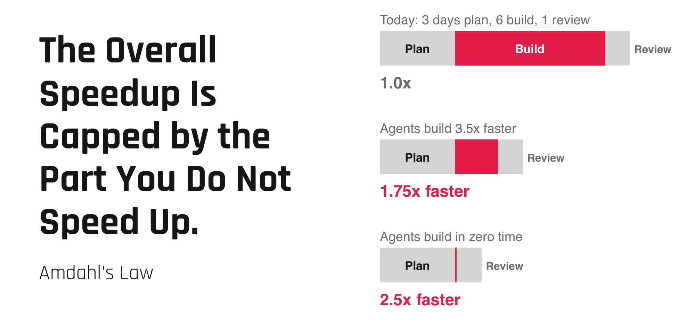
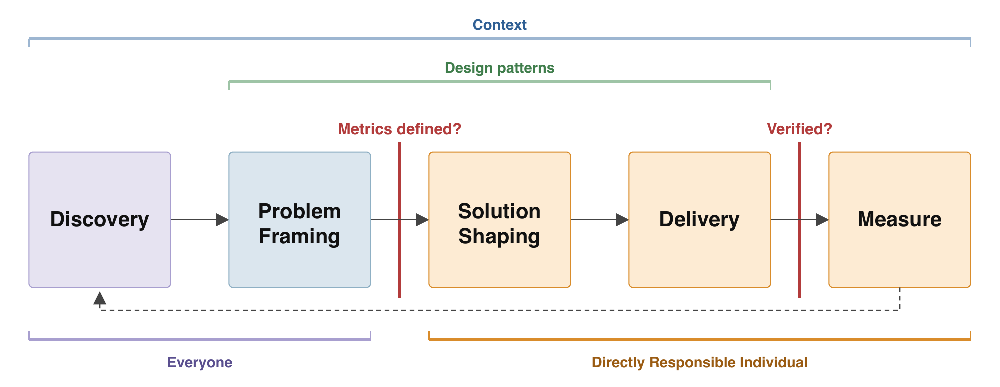
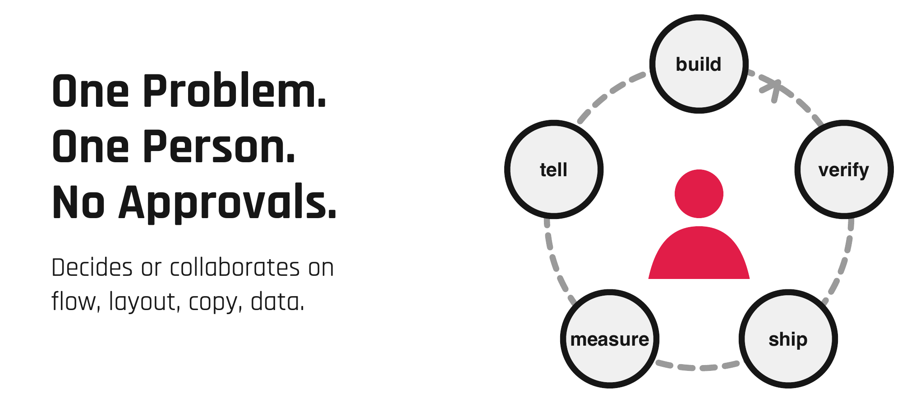
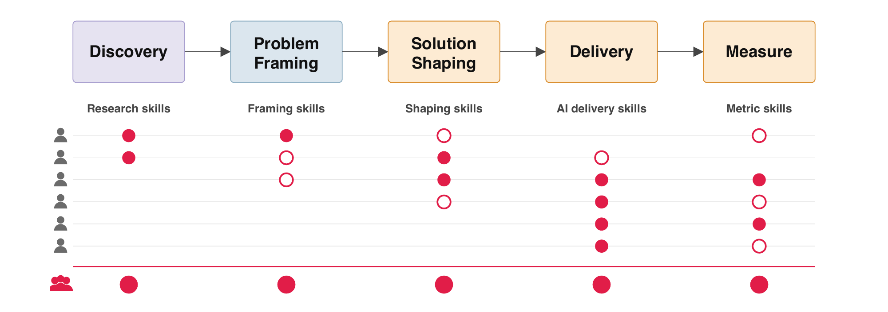

This is the long version of my [talk at code.talks]() in Hamburg: how I am transforming my current team at [myo](https://myo.de). What worked for us, what did not, and what we are still figuring out.

Here is what worked in our context. Your context is different.

## Our Past: The Best Process I Ever Had

Our old process was Shape Up. Product was no longer the bottleneck, and the team carried a lot of ownership. It was the best process I ever had.

Then I noticed something uncomfortable. Alone with agents, I am faster than the team.

Not because the people are slow. Because of what we wait for:

- Consensus before building.
- The code review queue.
- The communication overhead.

What costs us is waiting on people. And [Amdahl's law](https://en.wikipedia.org/wiki/Amdahl%27s_law) applies:

The numbers come from Sashank Gondala, CTO of FurtherAI: [Building an AI-native Engineering Org](https://x.com/sgondala2/status/2115832070274723875). Three days of planning, six days of building, one day of review. Even if agents build in zero time, the whole gets only 2.5 times faster.

The industry answer right now is software factories, product factories, GTM factories. [John Cutler asks](https://cutlefish.substack.com/p/tbm-448-the-software-factory-as-identity) whether we are reimagining work one silo at a time. I think we are.

My picture for the alternative is Amsterdam's [Alexanderplein experiment](https://bikecity.amsterdam.nl/en/experiment-traffic-lights-disabled-and-gone-2/). The city switched the traffic lights off at a busy intersection. Traffic kept flowing. People looked at each other instead of waiting for a signal. (I got the inspiration from [Sander Hoogendoorn](https://sanderhoogendoorn.com/articles/).)

## Our Present: One Problem, One Person, No Approvals

Here is how we work now. [Shape Up](https://basecamp.com/shapeup) is not gone, it is becoming part of our toolbelt. The most important thing we kept was not even in the original book: the split into framing and shaping, which Ryan Singer describes in [a later blog post](https://www.ryansinger.co/framing/).

**Problem framing.** Whoever brings a problem frames it: context, outcome, no-gos, risk appetite, metric. No problem framing, no solution shaping.

**Directly responsible individuals.** The question was: how do we get a team as fast as one person? The answer: one problem, one person, no approvals. The DRI decides or collaborates on flow, layout, copy and data. As a leader, I had to let go of the how.

**Solution shaping.** The DRI clarifies details directly with stakeholders and collaborates in whatever way fits: prototypes, breadboarding, a quick call. Estimates are a ballpark. No consensus, but feedback.

**Delivery with agents.** Engineers need to learn to prompt for verification. The question I keep asking: how would you gain confidence if you could not read the code?

- Agents build, the DRI steers.
- Prompt the what, not the how.
- Ask for irrefutable proof, not vibes.
- Design patterns and a design.md instead of design approvals.
- AI reviews every PR, the DRI merges. Four eyes only if the DRI asks for them.

If you can't say how it was verified, don't merge.

**Guardrails.** A soft guard: critical paths live on a path list. A hard guard: separate packages the agent cannot edit at all. Autonomy grows with distance from customer data.

**Measure with real numbers.** Real cases ran, and the metric is live if there is one. A bug means we first improve the verification. Agents can reach errors and telemetry. Everyone sees the metrics.

**Context.** If the agent can't see something, it makes it up. So context is now a product in itself: strategy, user types, interviews and framings on the product side, a pattern set and design.md on the design side, telemetry, logs and errors from production.

**Makers, not silo factories.** The team stays the unit of value creation. So I no longer ask whether I need a product person. I ask whether the team as a whole covers every skill: research, framing, shaping, AI delivery, metrics.

A simple matrix shows me that: one row per person, one column per skill. It also shows me how to develop engineers into other areas.

## Your Future: Find Your Own Process

There is no single best solution. Apple's "measure twice, cut once" and Google's "launch, iterate and kill" are both valid, depending on what you build and for whom.

A few things I would take with me:

- Treat everything as an experiment. Grafana uses error budgets, as Mat Ryer explains on [The Changelog #526](https://changelog.com/podcast/526) and [Changelog & Friends #123](https://changelog.com/friends/123): a certain level of errors is allowed, so teams can be creative and make mistakes. Zero errors all the time means you are not innovating enough.
- "Consensus kills speed, top-down kills buy-in," says [Claus Höfele](https://claushoefele.com/d2l). Leaders: don't bring answers, facilitate shared learning.

## Replace Consensus With Context

Two questions everyone should ask themselves these days:

- Does every agent have the context to work autonomously?
- Is every human empowered to work autonomously?

You can derive pretty much everything else from them.
