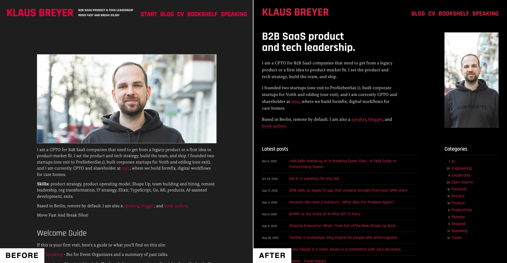
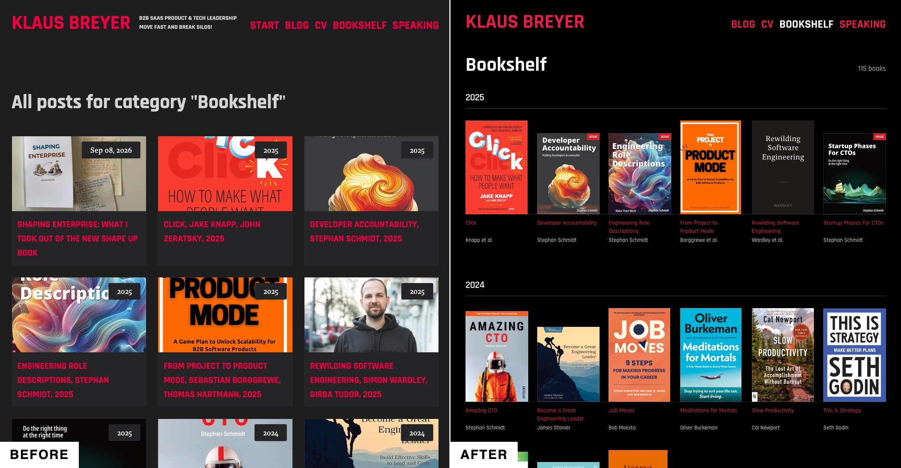
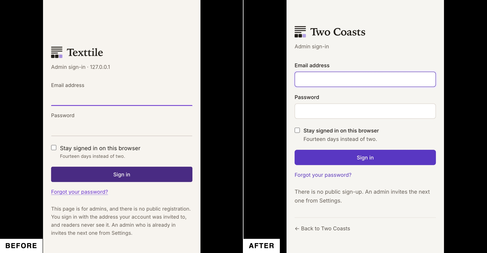
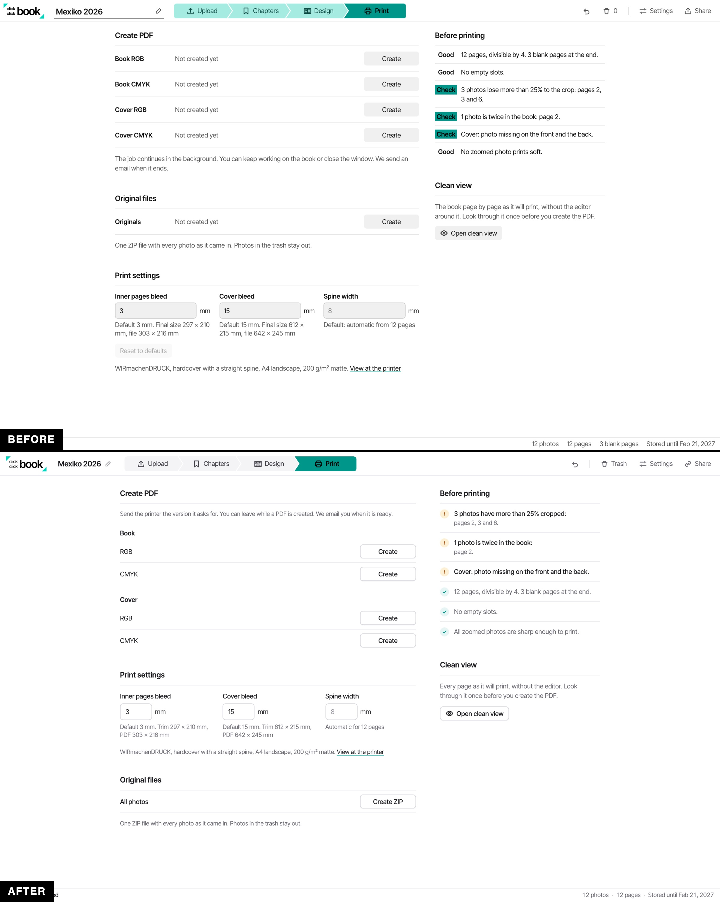

I am not a designer. When I vibe an interface together with AI, it works. It also looks vibed.

Then I watched Theo's video [Agents Sucked At UI (Until Today)](https://www.youtube.com/watch?v=xq0eB8vxeqk). Mind blown: he uses a hillclimb for UI.

So I let AI improve the design of this blog.

The Bookshelf went from cropped cards to a wall of covers:

## What is a hillclimb?

You give an agent a goal it can check, and it works until it gets there. "Make this test pass." "Make this function five times faster." The agent tries something, measures, and tries again.

That is easy when a program can measure the result. But who measures design?

Theo's answer is a council. Three models from three providers look at screenshots of the app, and each gives a score from 1 to 10. The agent changes the UI, takes new screenshots and asks again. It stops when every member says 9 or better.

## The prompt

I used roughly Theo's prompt, with my own council:

> /goal improve the ui. Should look way better and easier on the eyes. Go at it until the council all agree that a set of screenshots of the app are at least a 9 out of 10 in terms of design quality.
>
> Make a new PR for "UI polish overhaul", and keep iterating until you have made the whole council happy.
>
> Generate your own screenshots with computer use or whatever other techniques you have available to you. Have each council member give scores on the UI, 1 to 10. When you get all of them to agree it is a 9/10 or better, you are done.
>
> Be thorough. Help clarify and simplify the UI. Make it designer-proof, I want professionals to be impressed with how clean and clear things are.
>
> The council is sol 6.1, opus 5.5 and gemini flash 3.8. Use gemini flash only in the first run and then if both of the others are over 8.5.

The council comes from Theo's [council skill](https://github.com/t3dotgg/tstack/blob/main/skills/council/SKILL.md). It tells the agent how to bring in the three models, collect their scores and start the next round.

## It is brute force

Nothing clever happens here. The agent tries, three models judge, the agent tries again. For hours.

But it works frighteningly well.

I ran it on three projects and on this blog. Each run takes a few hours, and afterwards the UI is crisp. Much better than what I get as a non-designer when I just vibe with the AI.

That is the point for non-designers who vibe. We cannot prompt the AI the way a designer could. With a hillclimb, we can build good products anyway.

For this blog, the whole run is one pull request with 46 commits: [UI polish overhaul](https://github.com/klausbreyer/v01.io/pull/57).

## Two more examples

Two of those projects are tools I am building right now.

One is a CMS, [Texttile](). This is the sign-in page:

Look at the fields. As a non-designer, I did not know that an input with only an underline is not good. So I would never have asked the AI to change it.

The other is a photo book tool. This is the print page:

Pick the interface you are least proud of, and give it a few hours.
