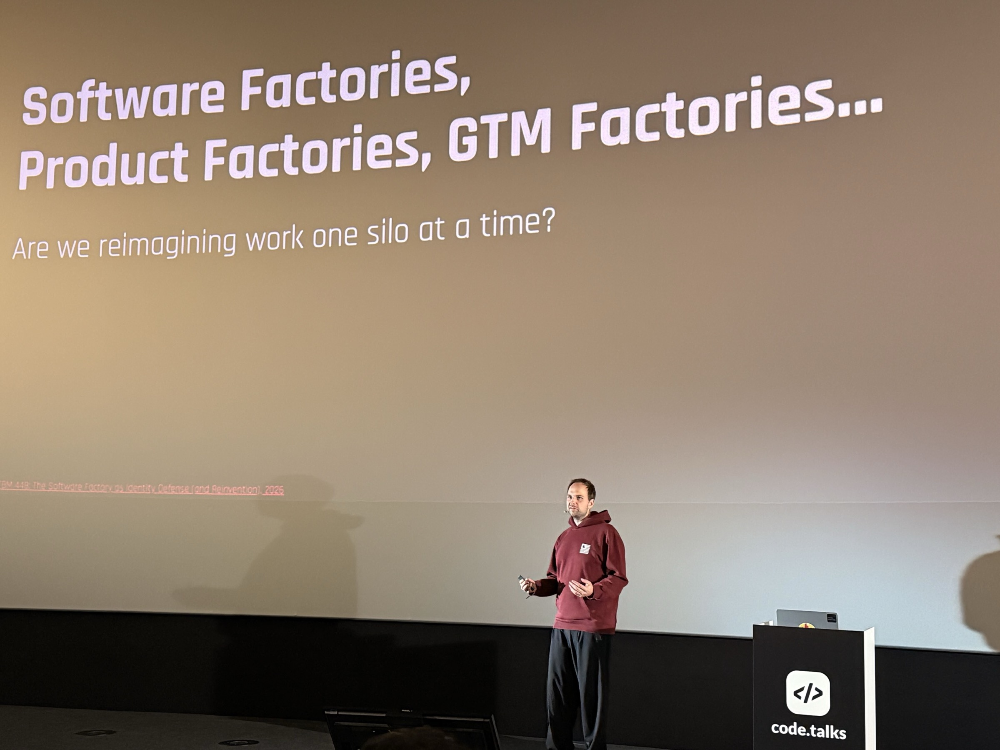

Today I'm speaking at code.talks in Hamburg, for the second year in a row.

Six months ago I applied with a different talk. The abstract promised a cross-role view on what AI does to teams, with examples from leading companies, plus the workshop format I had [run with my team]() in May.

Six months is a long time right now. Everything changes, every few weeks.

So I threw the abstract away. Instead I tell the story of how I am transforming my current team at [myo](https://myo.de). What worked for us, what did not, and what we are still figuring out.

Last year's talk, [Move Fast and Break Silos](), was about interdisciplinary teams without AI. This one is about what happens to those teams when the agents arrive.

## Slides



[Download Slides](2026-codetalks.pdf)
